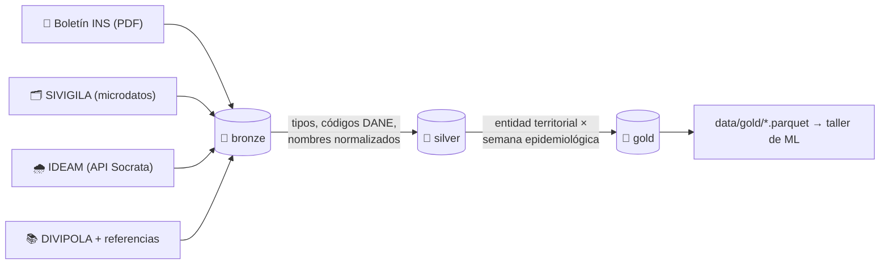

# 🦟 Del PDF a la tabla oro

**Taller de ingeniería de datos · Hackathon Loka × WIE ICESI 2026**

Cada semana, una secretaría de salud en Colombia abre un PDF y descubre que el dengue
ya llegó. La información para anticiparlo existe, pero está repartida en tres fuentes
que nadie cruza: un **boletín en PDF**, unos **microdatos** que pocos saben usar y una
**API de clima** con más de 165 millones de filas.

Este repositorio es el punto de partida del taller: un pipeline **piloto** que lleva
esas tres fuentes a **una sola tabla** (una fila por entidad territorial y semana
epidemiológica) lista para gráficas y modelos.

> **Importante:** esto es un *piloto* didáctico (2 departamentos, 2 boletines, solo
> lluvia). **No resuelve el reto**: muestra la técnica una vez y deja las preguntas
> difíciles abiertas en [`RETOS.md`](RETOS.md).

## ¿Qué vas a aprender?

* Extraer una tabla de un PDF que cambia de forma cada semana (y comprobar que no perdiste filas).
* Pedirle a una API que agregue los datos por ti en vez de descargar millones de filas.
* Cargar todo en una base de datos analítica (**DuckDB**) y transformarlo con **SQL**.
* Organizar el trabajo en capas **bronce → plata → oro**.
* Cazar las trampas reales de los datos públicos colombianos: fechas guardadas como texto,
  nombres que no coinciden, semanas epidemiológicas, distritos que se reportan aparte…

## ⚡ Inicio rápido

Elige **una** de estas tres opciones.

### Opción A · En el navegador, sin instalar nada (molab)

[](https://molab.marimo.io/github/davidvanegas2/dengue-pipeline/blob/main/notebooks/workshop.py)

1. Abre el badge e inicia sesión cuando molab lo solicite.
2. Crea una copia editable en tu cuenta (**Fork**) y ejecútala en un servidor Python
   (**Server**). La vista previa por sí sola no permite resolver los TODOs; la opción
   WebAssembly no está validada para las dependencias de este taller.
3. Ejecuta todas las celdas con ▶. Los datos se descargan solos (ver `REPO_URL` al inicio).
   Los checkpoints pendientes al abrir son parte del ejercicio.

**Preparación del evento:** este acceso sigue pendiente de un ensayo con cuenta nueva.
El repositorio se mantiene público para facilitar las pruebas. Consulta el
[checklist del facilitador](docs/guia_facilitador.md).

### Opción B · En tu computador (recomendada para la hackathon)

Necesitas [uv](https://docs.astral.sh/uv/getting-started/installation/) (instala Python
por ti) y Git.

```bash
git clone https://github.com/davidvanegas2/dengue-pipeline.git
cd dengue-pipeline
uv sync --locked                         # instala las versiones de uv.lock
uv run dengue-pipeline run                # corre el pipeline completo, sin internet
uv run marimo edit notebooks/workshop.py   # abre el taller en el navegador
```

### Opción C · GitHub Codespaces

Botón **Code → Codespaces → Create codespace**. El contenedor instala todo y corre el
pipeline. Luego: `uv run marimo edit notebooks/workshop.py`.

## Comandos

Con `make` (macOS / Linux) o con el comando `uv` equivalente (Windows):

| `make …` | Equivalente | Qué hace |
|---|---|---|
| `make install` | `uv sync && uv run pre-commit install` | Instala dependencias y hooks de git |
| `make workshop` | `uv run marimo edit notebooks/workshop.py` | Abre el taller (con ejercicios) |
| `make pipeline` | `uv run dengue-pipeline run` | Bronce → plata → oro, sin internet |
| `make pipeline-online` | `uv run dengue-pipeline -v run --refresh-ideam` | Igual, descargando el IDEAM de nuevo |
| `make lint` | ver `Makefile` | ruff, sqlfluff, mypy, marimo check |
| `make format` | `uv run ruff format . && uv run sqlfluff fix sql` | Formatea Python y SQL |
| `make test` | `uv run pytest --cov` | Todas las pruebas, con cobertura |
| `make workshop-check` | [Secuencia sin make](docs/guia_facilitador.md#ensayo-técnico-repetible) | Lint, pruebas offline incluidos notebooks y pipeline |
| `make workshop-qr` | `uv run scripts/generate_workshop_qr.py` | Genera los QR localmente en `docs/assets/` |

`make test-fast` omite los notebooks. Para preparar el taller usa `make workshop-check`;
la instalación inicial necesita internet. El ensayo con API en vivo va por separado.

La línea de comandos del pipeline tiene ayuda: `uv run dengue-pipeline --help`.

```text
dengue-pipeline run            # todo el pipeline + verificaciones de calidad
dengue-pipeline check           # solo las verificaciones sobre la bodega existente
dengue-pipeline bulletin <pdf>       # extrae la tabla de dengue de un boletín del INS
dengue-pipeline prepare-sivigila   # convierte descargas de SIVIGILA en el archivo del piloto
dengue-pipeline download-ideam     # descarga la lluvia del piloto desde datos.gov.co
```

## Arquitectura



* **Bronce:** los datos tal como llegan (los CSV se leen *todo como texto*).
* **Plata:** tipos correctos, códigos DIVIPOLA completos, semanas epidemiológicas.
* **Oro:** `gold.weekly_dengue_signal`, descrita en el [diccionario de datos](docs/diccionario_de_datos.md).

Las decisiones de diseño (por qué DuckDB, por qué marimo, por qué SQL en archivos) están
en [`docs/arquitectura.md`](docs/arquitectura.md).

## Estructura

```text
├── notebooks/
│   ├── workshop.py              ← el taller, con ejercicios (GENERADO, no editar)
│   └── workshop_facilitator.py  ← el taller resuelto (fuente de verdad)
├── src/dengue_pipeline/         ← el pipeline como paquete de Python
│   ├── extract/                ← bulletin.py · sivigila.py · ideam.py
│   ├── warehouse.py            ← DuckDB: esquemas bronze/silver/gold
│   ├── transform.py            ← ejecuta los archivos SQL en orden
│   ├── quality.py              ← verificaciones de calidad de datos
│   ├── pipeline.py · cli.py     ← orquestación y línea de comandos
│   └── weeks.py · text.py       ← semana epidemiológica, números y nombres colombianos
├── sql/
│   ├── macros.sql              ← funciones SQL reutilizables
│   ├── silver/                 ← 01_references · 02_sivigila · 03_ideam · 04_bulletin
│   └── gold/                   ← 01_weekly_dengue_signal
├── data/
│   ├── raw/                    ← boletines (extractos), SIVIGILA, IDEAM
│   ├── reference/              ← DIVIPOLA, entidades territoriales, alias de nombres
│   └── gold/                   ← la tabla final exportada (parquet)
├── tests/                      ← pytest: unidades, pipeline completo y notebooks
├── scripts/                    ← generador del notebook y de la muestra sintética
├── docs/                       ← fuentes, arquitectura, diccionario, guía del facilitador
└── RETOS.md                    ← las incógnitas para la hackathon
```

## Fuentes de datos

| Fuente | Qué trae | Formato | En este repo |
|---|---|---|---|
| Boletín Epidemiológico Semanal (INS) | Casos acumulados por entidad territorial, año en curso | PDF | Extractos de las semanas 26 y 27 de 2026 |
| SIVIGILA (INS) | Un registro por caso, años cerrados desde 2007 | Excel / CSV | Microdatos reales 2024-2025 (dengue y dengue grave), Valle y Atlántico |
| IDEAM (datos.gov.co) | Lluvia por estación cada 10 minutos | API Socrata | Suma diaria 2024-2026, Valle y Atlántico |
| DIVIPOLA (DANE) | Códigos oficiales de municipios | API Socrata | Valle y Atlántico |

Detalles, enlaces y trampas conocidas: [`docs/fuentes.md`](docs/fuentes.md).

> **SIVIGILA:** los microdatos se descargan a mano desde el portal del INS. El repositorio
> trae los de 2024-2025 para el piloto; `data/raw/sivigila/ORIGEN.txt` dice si son reales
> (`INS`) o una muestra con números inventados (`SINTETICO`). Cómo cambiarlos:
> [`data/raw/sivigila/LEEME.md`](data/raw/sivigila/LEEME.md).

## Calidad del código

Este repositorio sigue las mismas prácticas que un proyecto profesional, para que lo
puedas usar como base en la hackathon:

| Herramienta | Para qué |
|---|---|
| [uv](https://docs.astral.sh/uv/) | Dependencias y entorno reproducible (`uv.lock`) |
| [ruff](https://docs.astral.sh/ruff/) | Linter y formateador de Python |
| [sqlfluff](https://sqlfluff.com/) | Linter y formateador de SQL (dialecto DuckDB) |
| [mypy](https://mypy-lang.org/) | Tipos estáticos (modo estricto) |
| `marimo check` | Linter de notebooks |
| [pytest](https://pytest.org/) | 125+ pruebas: unidades, pipeline completo y notebooks |
| [pre-commit](https://pre-commit.com/) | Corre todo lo anterior antes de cada commit |
| GitHub Actions | El mismo `make lint` + pruebas en cada push |

El código, sus comentarios y los comandos están en inglés. La documentación y las
explicaciones del taller están en español. Los campos y valores originales de las
fuentes se conservan al leerlos; las tablas de plata y oro usan nombres en inglés.

Cómo contribuir: [`CONTRIBUTING.md`](CONTRIBUTING.md).

## Créditos

* Datos: Instituto Nacional de Salud (INS), IDEAM y DANE, publicados como datos abiertos.
* Taller preparado para la Hackathon Loka × Women in Engineering ICESI (diciembre 2026).
* Código bajo licencia [MIT](LICENSE).
