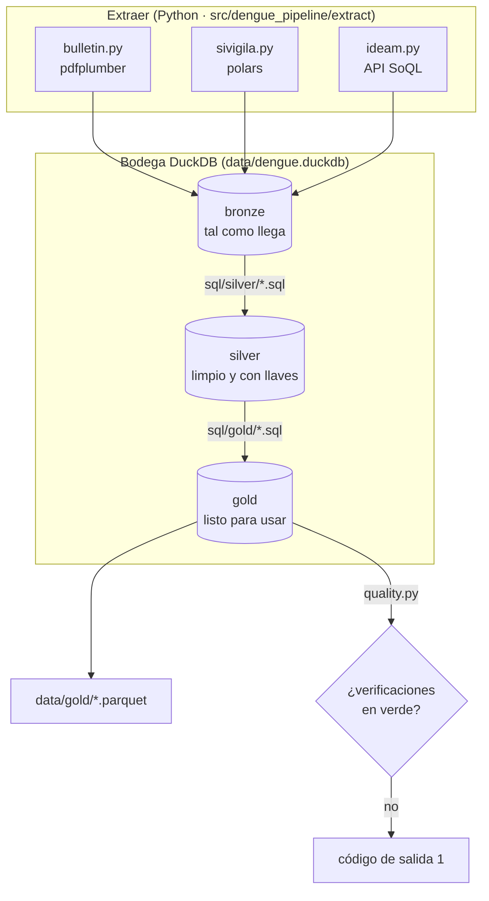

# Arquitectura y decisiones de diseño

## Flujo

## Decisiones

### DuckDB como base de datos

| Alternativa | Por qué no, para este caso |
|---|---|
| SQLite | Pensada para aplicaciones (OLTP), no para análisis; no lee Parquet/Excel con SQL |
| PostgreSQL | Necesita servidor o Docker; no corre en un notebook en la nube |
| Solo pandas/polars | El reto pide una base de datos; SQL es lo más transferible |
| BigQuery / Snowflake | Cuentas en la nube y no son open source |
| Spark | Hecho para clusters; estos datos caben en un portátil |

DuckDB es un solo archivo, sin servidor, rápido para análisis, lee CSV, Parquet y JSON
directamente y consulta DataFrames de Python por nombre. Limitación: un solo proceso
escribe a la vez. Para una hackathon da igual.

### marimo en vez de Jupyter / Colab

* **Reactivo:** cambiar una celda vuelve a ejecutar las que dependen de ella. No hay
  "estado escondido" ni resultados viejos en pantalla: ideal para enseñar.
* **Archivos `.py`:** se versionan con git como cualquier código, pasan por `ruff` y se
  pueden ejecutar como script (así los prueban los tests).
* **Interactivo sin esfuerzo:** botones, deslizadores, interruptores, PDF embebido.
* **Se puede correr en la nube** con molab, en local con `uv` o en Codespaces.

### Transformaciones en archivos `.sql`

Se pueden leer, revisar y *lintear* (sqlfluff) como cualquier código, y el orden se
controla con el prefijo numérico (`01_`, `02_`…). Es la misma idea de dbt, sin agregar
otra herramienta al taller.

### Bronce = texto

Los CSV se cargan con `all_varchar = true`. Si la librería adivina tipos, `08` se vuelve
`8` y se pierde información. Los tipos se deciden en plata, explícitamente.

### Banderas, no filtros

Los datos dudosos (lluvia imposible, lecturas duplicadas) se **marcan** en plata
(`suspicious_reading`) en vez de borrarse. Borrar es una decisión de análisis y debe quedar
visible y documentada.

### Validar contra el propio documento

Cada boletín se valida contra su fila *Total*. Si la suma de las entidades no coincide,
se perdió una fila al extraer. Es la prueba más barata y efectiva para un PDF.

### Determinismo

La lluvia se convierte a `DECIMAL` (no `DOUBLE`) antes de agregarse: las sumas en
paralelo con `DOUBLE` pueden variar en el último decimal entre ejecuciones, y una tabla
oro que cambia sin que cambien los datos rompe la reproducibilidad.

### Una sola fuente de verdad para el notebook

`notebooks/workshop_facilitator.py` tiene las soluciones; `notebooks/workshop.py` se genera
con `scripts/generate_student_notebook.py`. Una prueba y un hook de pre-commit
verifican que estén sincronizados.

## A dónde crecer

Herramientas que **no** se usan en el piloto para no saturar el taller, pero que
resuelven problemas reales cuando el proyecto crece:

| Necesidad | Herramienta |
|---|---|
| Organizar y documentar muchas transformaciones SQL | [dbt](https://www.getdbt.com/) o [SQLMesh](https://sqlmesh.com/) |
| Correr el pipeline cada semana, con reintentos y alertas | [Dagster](https://dagster.io/), [Prefect](https://www.prefect.io/), [Airflow](https://airflow.apache.org/) |
| Validar esquemas y reglas de calidad | [Pandera](https://pandera.readthedocs.io/), [Great Expectations](https://greatexpectations.io/) |
| Tablas difíciles en PDF | [Camelot](https://camelot-py.readthedocs.io/), `pdfplumber.extract_words()` |
| Cruzar estaciones con municipios por coordenadas | Extensión `spatial` de DuckDB |
| Publicar un tablero | [Streamlit](https://streamlit.io/), o el mismo notebook con `marimo run` |
